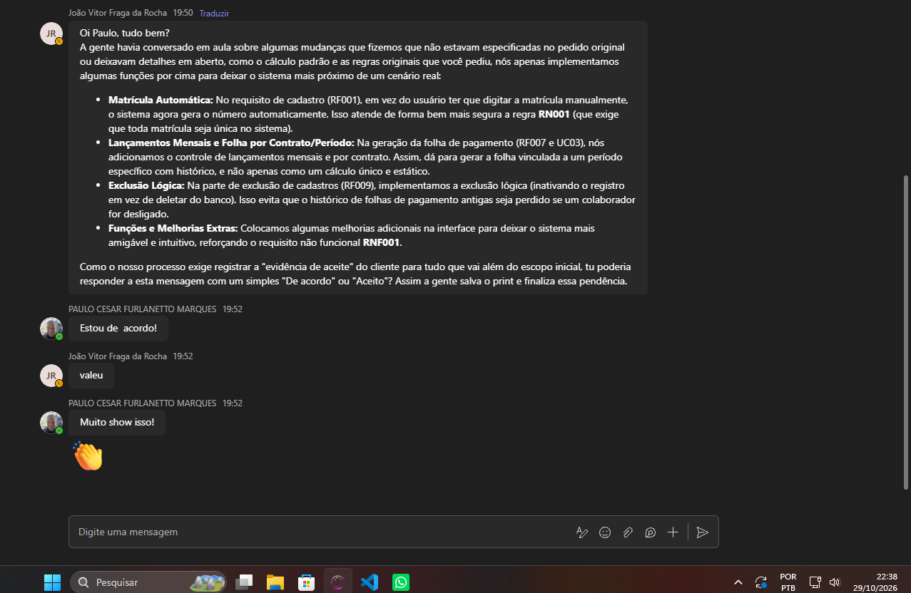

# Registro de Aceite de Desvios

Controla a aprovação, pelo cliente (professor/responsável pelo projeto), dos pontos em que o sistema
difere ou amplia o documento de requisitos do cliente. Descrição dos desvios: `ERS.md`, seção
"Desvios em relação ao documento do cliente".

**Regra:** um desvio só passa a "Aceito" com evidência datada (e-mail, mensagem da plataforma, ata).
Decisão atribuída ao "responsável" sem evidência continua **Pendente**.

| ID | Desvio | Decisão da equipe | Situação | Data do aceite | Quem aceitou | Evidência (arquivo/link) |
|---|---|---|---|---|---|---|
| D1 | Regime de metas, progressão, bônus e teto (RN009–RN011) | Cálculo padrão = fórmulas do cliente; regime de metas opcional, desligado por padrão | Padrão resolvido; opcional Aceito | 29/10/2026 | Prof. Paulo Cesar Furlanetto Marques ||
| D2 | Vendas/produção lançadas por mês (RF015) | Manter | Aceito | 29/10/2026 | Prof. Paulo Cesar Furlanetto Marques | |
| D3 | Exclusão lógica no lugar de exclusão física (RF009/RF013) | Manter | Aceito | 29/10/2026 |Prof. Paulo Cesar Furlanetto Marques | |
| D4 | Folha só de quem tem contrato no mês (RF007/RN014) | Manter | Aceito | 29/10/2026 | Prof. Paulo Cesar Furlanetto Marques | |
| D5 | Matrícula gerada automaticamente (RF001/RN001) | Manter | Aceito | 29/10/2026 | Prof. Paulo Cesar Furlanetto Marques | |
| D6 | Funções extras: login, perfis, fechamento, recibo, histórico | Manter | Aceito | 29/10/2026 | Prof. Paulo Cesar Furlanetto Marques | |

## Como preencher
1. Envie ao professor/cliente a mensagem abaixo (ou equivalente) e guarde a resposta em `01_Requisitos/evidencias/`.
2. Preencha data, quem aceitou e o nome do arquivo de evidência na linha correspondente.
3. Atualize a coluna "Aceite do cliente" da matriz de rastreabilidade na `ERS.md`.
4. Se algum desvio for recusado, remova-o do sistema ou deixe-o desativado, e ajuste os testes.

## Modelo de mensagem
> Prezado professor, no projeto Folha de Pagamento (Grupo 10) o cálculo padrão segue exatamente as fórmulas do
> documento do cliente (comissão = vendas × %; produção = quantidade × valor unitário, somados ao salário base).
> Mantivemos ainda cinco decisões que ampliam o escopo: (D2) vendas e produção lançadas por mês; (D3) exclusão lógica;
> (D4) folha apenas de quem tem contrato no mês; (D5) matrícula gerada automaticamente; (D6) login, perfis,
> fechamento e recibo. Também temos um regime opcional de metas (desligado por padrão). Pedimos a confirmação
> de que podemos manter esses itens, ou a indicação dos que devem ser removidos.
