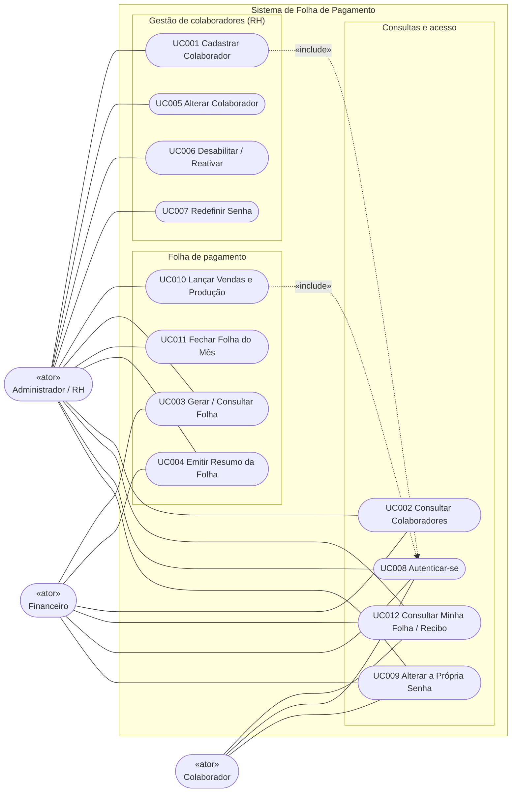

# 3. Casos de Uso

Atores: Administrador/RH (nível 1), Financeiro (nível 2) e Colaborador (nível 3).

## Lista de casos de uso
| Código | Nome | Ator(es) | Requisitos |
|---|---|---|---|
| UC001 | Cadastrar Colaborador | RH | RF001–RF004 |
| UC002 | Consultar Colaboradores | RH, Financeiro | RF005, RF018 |
| UC003 | Gerar Folha de Pagamento | RH (gera); RH e Financeiro (consultam) | RF006, RF007, RF014, RF019 |
| UC004 | Emitir Resumo da Folha | RH, Financeiro | RF008, RF020 |
| UC005 | Alterar Colaborador | RH | RF009 |
| UC006 | Desabilitar / Reativar Colaborador | RH | RF013 |
| UC007 | Redefinir Senha de Colaborador | RH | RF011 |
| UC008 | Autenticar-se | Todos | RF010, RF012 |
| UC009 | Alterar a Própria Senha | Todos | RF011 |
| UC010 | Lançar Vendas e Produção do Mês | RH | RF015 |
| UC011 | Fechar Folha do Mês | RH | RF016 |
| UC012 | Consultar Minha Folha / Recibo | Todos (nível 3 só mês fechado) | RF017 |

## Diagrama de Casos de Uso
Notação UML: atores fora da **fronteira do sistema**, casos de uso em elipses e generalização entre atores.
O Mermaid não tem diagrama de casos de uso nativo; por isso o diagrama abaixo usa `flowchart` com a fronteira desenhada
(`subgraph`) e os atores marcados com «ator». A versão em notação UML completa (atores em "bonequinho") está em
[`Casos_de_Uso.puml`](Casos_de_Uso.puml) (PlantUML).

Associações (conforme a tabela acima): UC009 *Alterar a Própria Senha*, UC008 *Autenticar-se* e UC012 *Consultar Minha Folha*
valem para **os três perfis**; Financeiro consulta (não altera) colaboradores, folha e resumo.

## Descrição dos casos de uso principais

### UC001 – Cadastrar Colaborador
| Campo | Valor |
|---|---|
| Código | UC001 |
| Ator | Administrador/RH |
| Objetivo | Registrar um novo colaborador com acesso ao sistema |
| Pré-condição | Usuário autenticado com nível 1 |
| Fluxo principal | 1. Informar nome, nascimento, início do contrato, nível, salário base e tipo. 2. Informar o dado do tipo (percentual de comissão ou valor por unidade). 3. Confirmar. 4. O sistema valida, gera a matrícula, grava e define a senha inicial (DDMMAAAA). 5. Exibe a lista com mensagem de sucesso. |
| Fluxo alternativo | 3a. Dado inválido (nome vazio, valor negativo, data inválida): o sistema não grava e exibe o erro no campo (HTTP 400). 3b. Usuário sem nível 1: acesso negado (403) e nada é gravado. |
| Pós-condição | Colaborador ativo cadastrado. |

### UC003 – Gerar Folha de Pagamento
| Campo | Valor |
|---|---|
| Código | UC003 |
| Ator | Administrador/RH |
| Objetivo | Calcular a folha de um mês |
| Pré-condição | Nível 1; mês ainda não fechado |
| Fluxo principal | 1. Escolher mês e ano e solicitar a geração. 2. O sistema seleciona quem tem contrato no mês. 3. Para cada um, calcula a remuneração pelas fórmulas do cliente (salário base + vendas × percentual, ou + quantidade × valor por unidade). Somente no modo opcional com metas o sistema também define a meta do mês a partir do mês anterior. 4. Exibe a folha do mês com o total. |
| Fluxo alternativo | 1a. Mês ou ano inválido: o sistema recusa e informa. 1b. Mês já fechado: o sistema recusa e informa. 1c. Usuário sem nível 1: acesso negado (403). 2a. Gerar de novo: só entram quem ainda não tem folha; folhas existentes não mudam. |
| Pós-condição | Folha do mês em situação ABERTO (prévia). |

### UC004 – Emitir Resumo da Folha
| Campo | Valor |
|---|---|
| Código | UC004 |
| Ator | RH ou Financeiro |
| Objetivo | Conhecer o custo total da folha |
| Fluxo principal | 1. Abrir Relatório e escolher o mês. 2. O sistema soma os salários finais, conta os colaboradores e agrupa por categoria. 3. Exibe o resumo e permite imprimir. |
| Fluxo alternativo | 2a. Mês sem folha: exibe mensagem. 2b. Mês aberto: mostra aviso de prévia. |

### UC008 – Autenticar-se
| Campo | Valor |
|---|---|
| Código | UC008 |
| Ator | Todos (RH, Financeiro e Colaborador) |
| Objetivo | Entrar no sistema com a matrícula e a senha |
| Fluxo principal | 1. Informar matrícula e senha. 2. O sistema valida e abre a sessão. 3. Direciona o nível 1/2 para Colaboradores e o nível 3 para Minhas folhas. |
| Fluxo alternativo | 2a. Credenciais inválidas ou usuário inativo: mensagem única, sem indicar qual dado errou. |

### UC010 – Lançar Vendas e Produção do Mês
| Campo | Valor |
|---|---|
| Código | UC010 |
| Ator | Administrador/RH |
| Objetivo | Informar os resultados do mês e recalcular |
| Pré-condição | Folha do mês gerada e ABERTA |
| Fluxo principal | 1. Abrir Lançamentos do mês. 2. Informar vendas (comissionados) e quantidade (produção). 3. Salvar. 4. O sistema valida, recalcula e atualiza a folha. |
| Fluxo alternativo | 3a. Valor negativo/inválido: nada é salvo e o erro é exibido. 3b. Mês fechado: tela somente leitura. |

### UC011 – Fechar Folha do Mês
| Campo | Valor |
|---|---|
| Código | UC011 |
| Ator | Administrador/RH |
| Objetivo | Congelar os valores do mês |
| Fluxo principal | 1. Selecionar o mês e escolher Fechar. 2. Confirmar a ação (não pode ser desfeita). 3. O sistema marca o período como FECHADO. |
| Pós-condição | Folhas do mês não podem mais ser alteradas, nem pelo banco. |

### UC012 – Consultar Minha Folha / Recibo
| Campo | Valor |
|---|---|
| Código | UC012 |
| Ator | Todos |
| Objetivo | Ver o próprio recibo |
| Fluxo principal | 1. Abrir Minhas folhas. 2. O sistema lista as folhas de meses fechados do usuário logado. 3. Abrir o recibo e, se quiser, imprimir. |
| Fluxo alternativo | 2a. Tentativa de abrir o recibo de outra pessoa (por URL): acesso negado (403), sem nenhum dado. |

### Demais casos (resumo)
| Código | Resumo |
|---|---|
| UC002 | Abrir Colaboradores, aplicar filtros (nome, salário máximo, tipo, status) e ver a lista. |
| UC005 | Selecionar Alterar, editar os campos e salvar; meses fechados não são afetados. |
| UC006 | Desabilitar: status Inativo e fim de contrato; perde o login e o histórico é preservado. Reativar devolve o acesso. Não é possível desabilitar a si mesmo nem o último administrador. |
| UC007 | RH aciona Redefinir senha; a senha volta a ser a data de nascimento (DDMMAAAA). |
| UC009 | Qualquer perfil logado informa senha atual, nova senha (mín. 6 caracteres) e confirmação; senha atual errada é recusada. |
