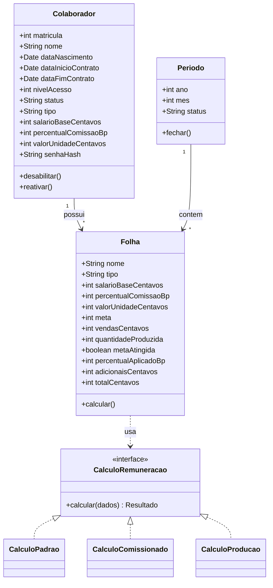
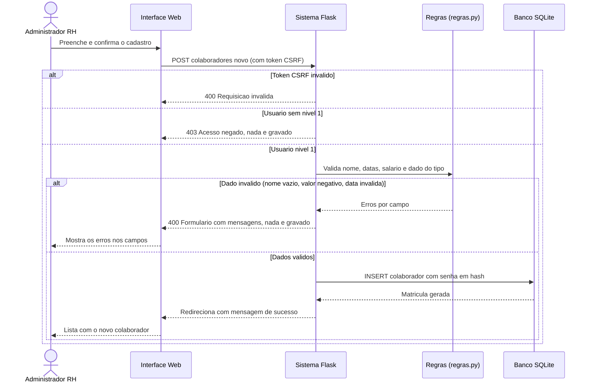
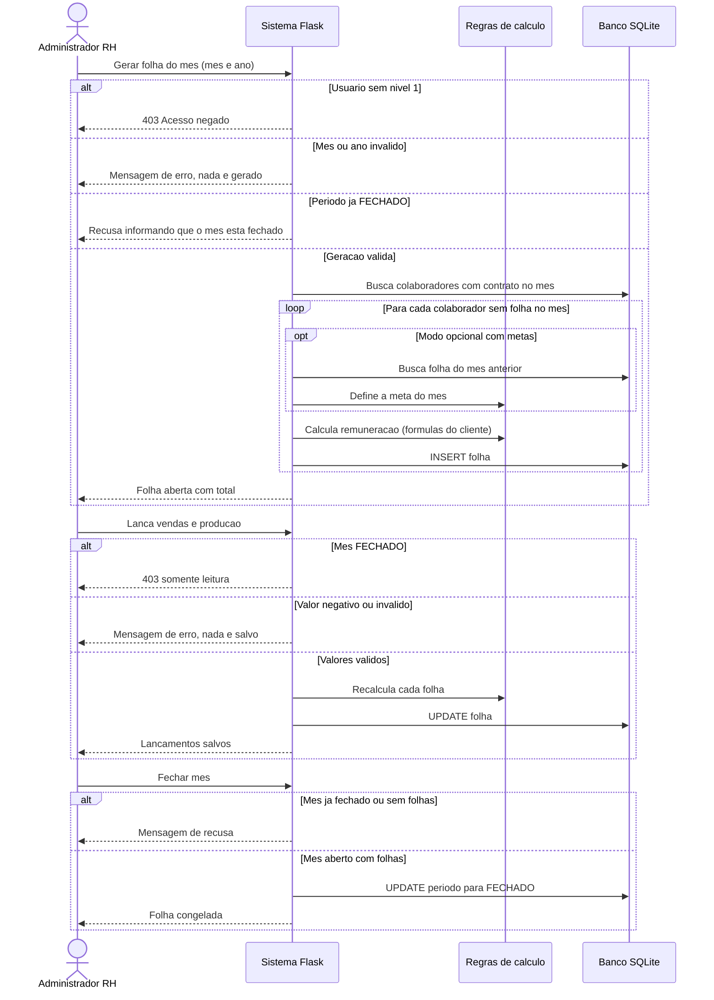
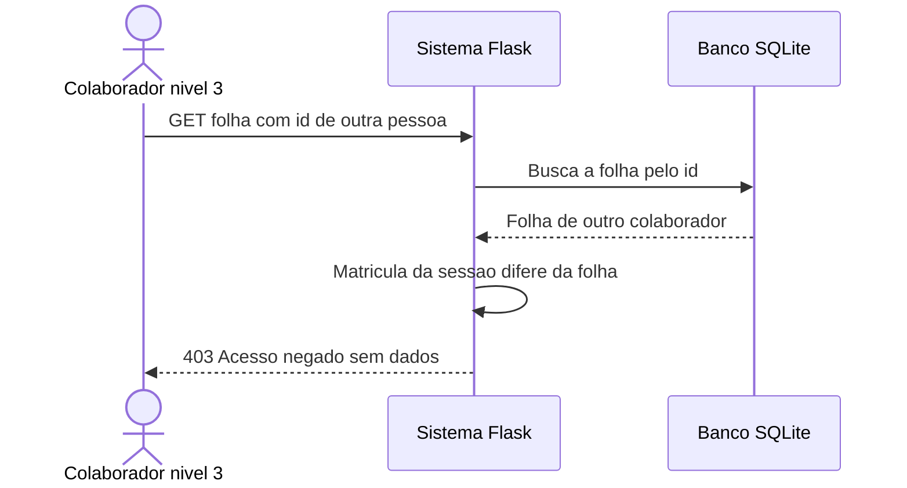
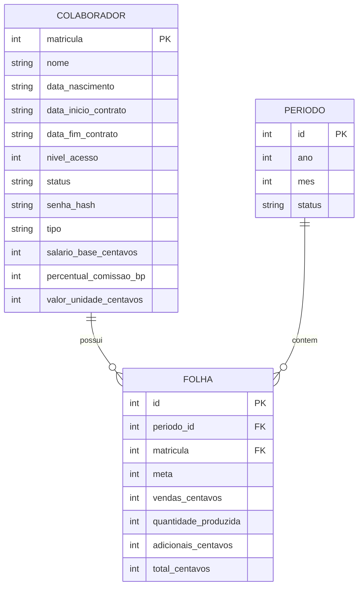
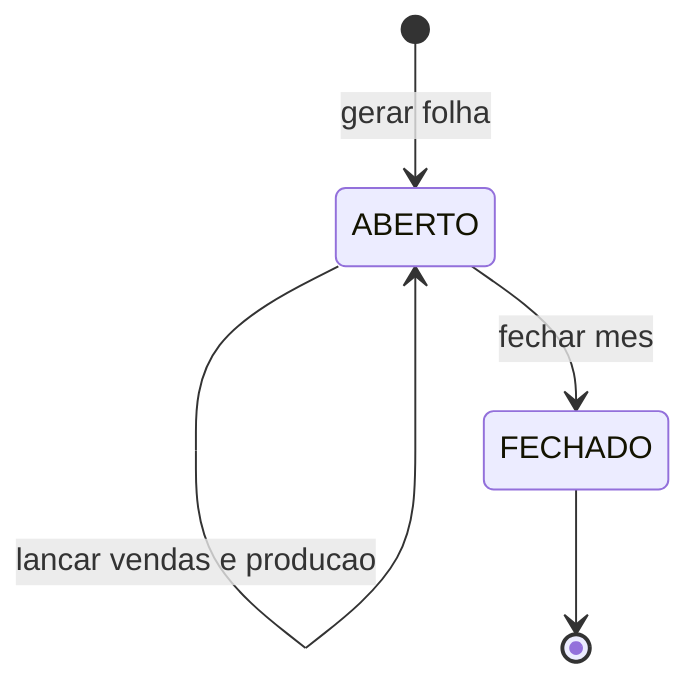

# 4. Diagramas UML

## Diagrama de Classes (modelo de domínio)
As estratégias de cálculo são implementadas como funções registradas em `CALCULADORES` (módulo `regras.py`);
no diagrama aparecem como classes para representar o padrão **Strategy** (RNF004). Cada calculador segue as fórmulas do cliente; o regime opcional de metas é um parâmetro (`regime_metas`) recebido pelos calculadores, desligado por padrão.

## Diagrama de Sequência – Cadastro de colaborador
Inclui o fluxo de sucesso e as rejeições previstas em UC001 (sem permissão e dado inválido).

## Diagrama de Sequência – Geração, lançamento e fechamento da folha
Inclui as rejeições de UC003, UC010 e UC011. O cálculo usa as fórmulas do cliente; a definição de meta só ocorre no modo opcional com metas.

## Diagrama de Sequência – Acesso negado ao nível 3

## Modelo de Dados (ER)

## Diagrama de Estados – Período da folha

