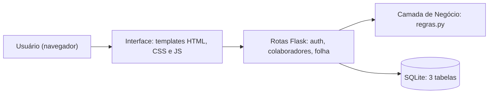

# 5. Documento de Arquitetura

## Arquitetura adotada
Aplicação web **monolítica em camadas**, com páginas geradas no servidor (server-side rendering).



| Camada | Responsabilidade | Arquivos |
|---|---|---|
| Interface | Telas, formulários, tema claro/escuro, impressão | `app/templates/`, `app/static/` |
| Rotas / Controle | Receber requisições, autorizar por nível, validar, orquestrar | `app/auth.py`, `app/colaboradores.py`, `app/folha.py`, `app/__init__.py` |
| Negócio | Cálculo, metas, conversão de dinheiro, validações puras | `app/regras.py` |
| Persistência | Conexão e esquema do banco | `app/db.py`, `app/schema.sql` |

## Tecnologias selecionadas
| Camada | Tecnologia | Justificativa |
|---|---|---|
| Front-end | HTML5, CSS3, JavaScript, Jinja2 | Sem build nem framework pesado; Jinja2 escapa a saída por padrão (proteção contra XSS). |
| Back-end | Python 3.10+, Flask 3, Werkzeug | Linguagem do sistema original; Flask é simples e fácil de testar com `test_client`. |
| Banco | SQLite 3 | Já vem com o Python, sem servidor, ideal para instalação simples (RNF006). |
| Segurança | Hash `scrypt` (Werkzeug), sessão assinada, CSRF, CSP | Boas práticas sem dependências extras. |
| Testes | `unittest`, Flask test client, `coverage.py` | `unittest` já vem no Python. |

## Justificativas técnicas (decisões)
| Decisão | Motivo |
|---|---|
| Regras de negócio em módulo puro (`regras.py`) | Podem ser testadas sem banco nem web (RNF008). |
| Cálculo por estratégias registradas (`CALCULADORES`) | Novo tipo de remuneração = nova função, sem mexer nas existentes (RNF004). |
| Fórmulas do cliente como comportamento padrão; metas como modo opcional (`REGIME_METAS`) | Garante aderência ao contrato original (RN008) e deixa a evolução (RN009–RN011) desligada até o aceite do cliente. |
| Dinheiro em **centavos inteiros** | Evita erro de ponto flutuante em folha (RNF007). |
| 3 tabelas apenas | Simplicidade exigida pelo projeto; histórico mensal fica na própria `folha`. |
| Folha como "fotografia" mensal | Valores e metas do mês ficam guardados; mudanças futuras não alteram meses fechados (RN012). |
| Exclusão lógica | Preserva histórico (RN016). |
| Autorização no backend (`@nivel_exigido`, matrícula da sessão) | Esconder botões não basta (RF012). |
| Triggers no banco |  Defesa em profundidade: impedem UPDATE e DELETE em folha de período fechado, mesmo por acesso direto ao banco; reabertura de período e INSERT são barrados só pela aplicação. |

## Organização dos componentes
```
05_Codigo_Fonte/
├── run.py, iniciar.bat, iniciar.sh   inicialização
├── app/
│   ├── __init__.py   fábrica do app, sessão, CSRF, cabeçalhos, filtros, erros
│   ├── auth.py       login, logout, senha, decorators de permissão
│   ├── colaboradores.py   cadastro, alteração, status, meus dados
│   ├── folha.py      geração, lançamentos, fechamento, recibo, relatório
│   ├── regras.py     dinheiro, metas e cálculo
│   ├── db.py, schema.sql
│   ├── templates/, static/
└── tests/test_sistema.py
```

## Configuração
| Variável | Efeito |
|---|---|
| `SECRET_KEY` | Chave de sessão (gerada em `instance/` se ausente) |
| `REGIME_METAS` | `0` (padrão): fórmulas do cliente. `1`: ativa o regime opcional de metas, progressão e teto |

## Estratégia de persistência
- SQLite em arquivo (`instance/folha.db`), criado automaticamente, junto com o administrador inicial.
- Todas as consultas usam parâmetros (`?`), evitando SQL injection.
- Operações de escrita fazem `commit` ao final de cada ação; chaves estrangeiras ativas (`PRAGMA foreign_keys`).
- Restrições (`CHECK`, `UNIQUE`) garantem valores não negativos, uma folha por mês e totais consistentes.
- Backup: copiar o arquivo `instance/folha.db`.

## Segurança (resumo)
Autenticação por sessão (cookie HttpOnly, SameSite=Lax, 8 h); revalidação do usuário a cada requisição (desabilitado perde o acesso na hora); CSRF em todo POST; CSP; senhas com hash; mensagens de erro genéricas no login.

## Limitações e riscos conhecidos
| Limitação | Impacto |
|---|---|
| SQLite aceita poucos acessos de escrita simultâneos | Adequado para uma empresa pequena |
| Sem cálculo proporcional (pró-rata) | Quem entra/sai no mês recebe o mês inteiro |
| Senha inicial previsível (data de nascimento) | Mitigada pelo aviso e pela troca no menu (troca não é obrigatória, por decisão do cliente) |
| Sem bloqueio por tentativas de login | Decisão do cliente; recomendado para produção |
