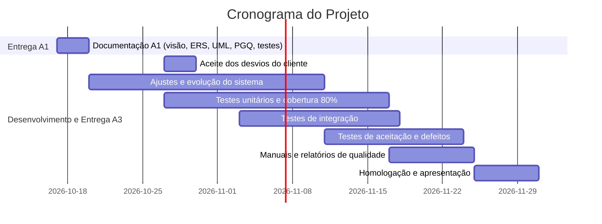

# 5.8 Planejamento do Projeto

## EAP (Estrutura Analítica do Projeto)

```mermaid
flowchart TD
    P["1 Projeto Folha de Pagamento"] --> G["1.1 Gerência"]
    P --> A["1.2 Análise e Projeto"]
    P --> D["1.3 Desenvolvimento"]
    P --> Q["1.4 Qualidade e Testes"]
    P --> M["1.5 Documentação"]
    P --> H["1.6 Homologação e Entrega"]
    G --> G1["Planejamento e cronograma"]
    G --> G2["Reuniões e controle de versão"]
    A --> A1["Visão e ERS"]
    A --> A2["Casos de uso e UML"]
    A --> A3["Arquitetura e modelo de dados"]
    D --> D1["Autenticação e permissões"]
    D --> D2["Cadastro de colaboradores"]
    D --> D3["Cálculo e metas"]
    D --> D4["Folha, fechamento e relatórios"]
    Q --> Q1["PGQ e Plano de Testes"]
    Q --> Q2["Casos de teste"]
    Q --> Q3["Testes unitários, integração e aceitação"]
    Q --> Q4["Defeitos e métricas"]
    M --> M1["Manual do usuário"]
    M --> M2["Manual técnico"]
    H --> H1["Revisão técnica e relatório final"]
    H --> H2["Termo de homologação"]
    H --> H3["Apresentação"]
```

## Cronograma

| Marco | Data |
|---|---|
| Entrega A1 | 20/10/2026 |
| Ajustes e evolução do sistema concluídos | 11/11/2026 |
| Cobertura ≥ 80% atingida (fim da atividade de testes unitários e cobertura) | 17/11/2026 |
| Aceite do cliente sobre os desvios D1–D6 registrado | 30/10/2026 |
| Fim da execução dos testes de aceitação | 24/11/2026 |
| Entrega A3 | 01/12/2026 |

## Distribuição de responsabilidades
| Papel | Responsável | Atividades |
|---|---|---|
| Gerente do projeto / Analista de requisitos | Yuri Soares | Cronograma, ERS, rastreabilidade, ata de revisão |
| Arquiteto / Desenvolvedor | João Vitor Fraga | Arquitetura, implementação, manual técnico |
| Analista de testes (QA) | Luiggi Bortolini | Plano de testes, casos de teste, execução, registro de defeitos, métricas |
| Documentação / Homologação | Pedro Kolling | Manual do usuário, termo de homologação, apresentação |

## Riscos
| Risco | Probabilidade | Ação |
|---|---|---|
| Desvios em relação ao cliente (D1–D6) sem aceite formal | Média | Cálculo padrão já segue as fórmulas do cliente; solicitar aceite dos demais desvios até 30/10/2026 e registrar em `01_Requisitos/Registro_de_Aceite_de_Desvios.md` |
| Cobertura de testes abaixo de 80% | Média | Medir cedo com `coverage` e priorizar rotas sem teste |
| Prazo curto no A1 | Alta | Reaproveitar os artefatos e priorizar os obrigatórios |

