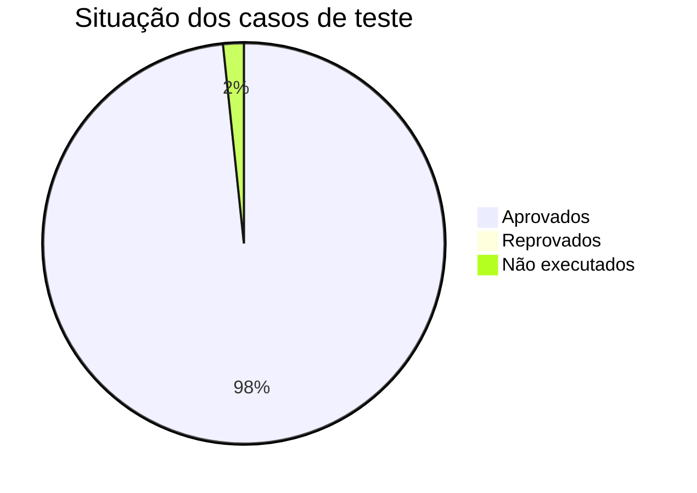

# Métricas e Indicadores de Qualidade

Entregável 6.7 e Dashboard de Métricas (Anexo I, item 19). As métricas são as do PGQ (`Plano_de_Garantia_da_Qualidade.md`, seção "Métricas Adotadas").
O bloco abaixo é **gerado por `05_Codigo_Fonte/atualizar_documentos.py`** a partir de `04_Testes/evidencias/`, `04_Testes/Casos_de_Teste.md`, `01_Requisitos/ERS.md`, `09_Homologacao/Testes_de_Aceitacao.md` e `10_Qualidade/Registro_de_Defeitos.md`. Para atualizar, rode `python gerar_cobertura.py`.

Fórmulas: casos aprovados ÷ executados; requisitos atendidos = RF e RN com ao menos um caso aprovado ÷ total de RF e RN; defeitos corrigidos = defeitos com status Corrigido, Homologado ou Fechado ÷ encontrados ("Não procede" não conta como corrigido nem como aberto).

<!--AUTO:metricas-->
| Métrica (PGQ) | Meta | Resultado | Como foi calculado |
|---|---|---|---|
| Cobertura de testes | ≥ 80% | **92%** (meta atingida) | `coverage report`, 634 linhas, 48 sem cobertura (16/11/2026 21:17) |
| Testes automatizados | — | **74** executados: OK, nenhum teste falhou | `evidencias/saida_unittest.md` |
| Casos de teste planejados | — | **58** códigos em 60 linhas | `Casos_de_Teste.md` (58 Auto, 2 Manual) |
| Casos executados | — | **59** de 60 linhas | Auto executados na suíte + manuais com resultado em `Testes_de_Aceitacao.md` |
| Casos aprovados ÷ executados | ≥ 95% | **100,0%** (59/59) | Auto aprovados (suíte OK) + manuais aprovados |
| Requisitos atendidos | 100% | **100,0%** (39/39 RF e RN) | RF/RN com ao menos um caso aprovado; sem caso aprovado: nenhum |
| Defeitos encontrados | acompanhar | **9** | `Registro_de_Defeitos.md` |
| Defeitos corrigidos | 100% dos críticos e altos | **8** de 9 | críticos/altos abertos: nenhum |
| Densidade de defeitos | acompanhar | **0,23** defeitos por requisito | defeitos ÷ 39 RF/RN |

<!--/AUTO-->
