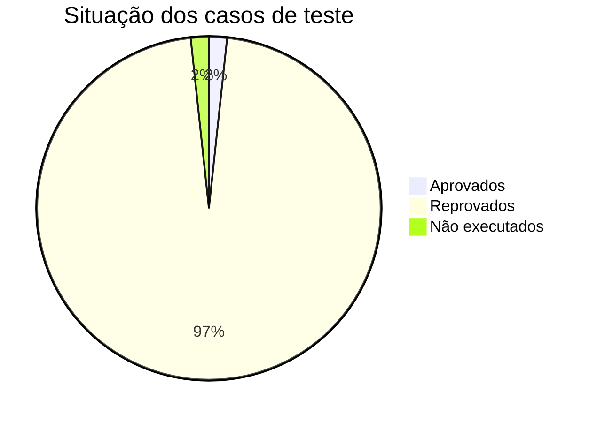

# Métricas e Indicadores de Qualidade

Entregável 6.7 e Dashboard de Métricas (Anexo I, item 19). As métricas são as do PGQ (`Plano_de_Garantia_da_Qualidade.md`, seção "Métricas Adotadas").
O bloco abaixo é **gerado por `05_Codigo_Fonte/atualizar_documentos.py`** a partir de `04_Testes/evidencias/`, `04_Testes/Casos_de_Teste.md`, `01_Requisitos/ERS.md`, `09_Homologacao/Testes_de_Aceitacao.md` e `10_Qualidade/Registro_de_Defeitos.md`. Para atualizar, rode `python gerar_cobertura.py`.

Fórmulas: casos aprovados ÷ executados; requisitos atendidos = RF e RN com ao menos um caso aprovado ÷ total de RF e RN; defeitos corrigidos = defeitos com status Corrigido, Homologado ou Fechado ÷ encontrados ("Não procede" não conta como corrigido nem como aberto).

<!--AUTO:metricas-->
| Métrica (PGQ) | Meta | Resultado | Como foi calculado |
|---|---|---|---|
| Cobertura de testes | ≥ 80% | **92%** (meta atingida) | `coverage report`, 634 linhas, 48 sem cobertura (12/11/2026 19:24) |
| Testes automatizados | — | **?** executados: ======================== 74 passed in 61.83s (0:01:01) ======================== | `evidencias/saida_unittest.md` |
| Casos de teste planejados | — | **57** códigos em 59 linhas | `Casos_de_Teste.md` (57 Auto, 2 Manual) |
| Casos executados | — | **58** de 59 linhas | Auto executados na suíte + manuais com resultado em `Testes_de_Aceitacao.md` |
| Casos aprovados ÷ executados | ≥ 95% | **1,7%** (1/58) | Auto aprovados (suíte OK) + manuais aprovados |
| Requisitos atendidos | 100% | **0,0%** (0/39 RF e RN) | RF/RN com ao menos um caso aprovado; sem caso aprovado: RF001, RF002, RF003, RF004, RF005, RF006, RF007, RF008, RF009, RF010, RF011, RF012, RF013, RF014, RF015, RF016, RF017, RF018, RF019, RF020, RF021, RN001, RN002, RN003, RN004, RN005, RN006, RN007, RN008, RN009, RN010, RN011, RN012, RN013, RN014, RN015, RN016, RN017, RN018 |
| Defeitos encontrados | acompanhar | **8** | `Registro_de_Defeitos.md` |
| Defeitos corrigidos | 100% dos críticos e altos | **7** de 8 | críticos/altos abertos: nenhum |
| Densidade de defeitos | acompanhar | **0,21** defeitos por requisito | defeitos ÷ 39 RF/RN |

<!--/AUTO-->
