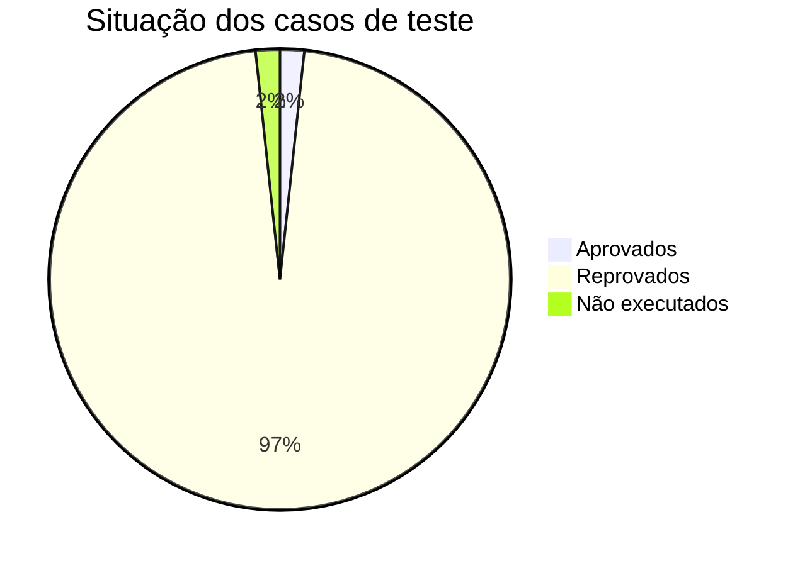

# Relatório Final de Qualidade

Entregável 6.12 (Anexo I, item 14). Números copiados automaticamente das evidências por `05_Codigo_Fonte/atualizar_documentos.py`.

## 1. Situação dos requisitos
| Grupo | Situação | Evidência |
|---|---|---|
| RF001–RF009 (cliente) | Implementados; cálculo pelas fórmulas do T1 | CT001–CT021 |
| RF010–RF018, RF020, RF021 (equipe) | Implementados; funções extras aceitas em D2–D6 (29 e 30/10/2026) | `01_Requisitos/Registro_de_Aceite_de_Desvios.md` |
| RF019 (modo opcional de metas) | Implementado, desligado por padrão; aceito (D1) em 30/10/2026 | CT035, CT045, CT054, CT055 |
| RN001–RN018 | Implementadas; RN012 também no banco | CT027, CT028, CT048 |
| RNF001 (interface) | Implementado; roteiro de usabilidade em `Testes_de_Aceitacao.md` seção C | CT039 |
| RNF002–RNF005, RNF007 | Atendidos | CT024–CT033, CT040–CT042 |
| RNF006 (dois cliques) | Implementado; execução manual em `Testes_de_Aceitacao.md` seção C | CT037-A, CT037-M |
| RNF008 (cobertura ≥ 80%) | Atendido (valor na seção 3) | CT043 |
| RNF009 (Windows) | Verificado no Windows 11 | CT044 |

## 2. Matriz de rastreabilidade
`01_Requisitos/ERS.md`, seção "Matriz de Rastreabilidade" (requisito → caso de uso → módulo → caso de teste → status → aceite do cliente), mais a coluna de resultado dos casos em `04_Testes/Casos_de_Teste.md` e `09_Homologacao/Testes_de_Aceitacao.md`.

## 3. Resultados dos testes e métricas
Última execução: <!--A:testes-->?<!--/A--> testes, <!--A:resultado-->======================== 74 passed in 61.83s (0:01:01) ========================<!--/A-->, cobertura <!--A:cobertura-->92%<!--/A--> (<!--A:data-->12/11/2026 19:24<!--/A-->, <!--A:ambiente-->3.13.3 / Windows-11-10.0.26200-SP0<!--/A-->, executor <!--A:executor-->Pedro da Silva Kolling<!--/A-->). Níveis de teste: `04_Testes/Relatorio_de_Testes.md`.

<!--AUTO:metricas-->
| Métrica (PGQ) | Meta | Resultado | Como foi calculado |
|---|---|---|---|
| Cobertura de testes | ≥ 80% | **92%** (meta atingida) | `coverage report`, 634 linhas, 48 sem cobertura (12/11/2026 19:24) |
| Testes automatizados | — | **?** executados: ======================== 74 passed in 61.83s (0:01:01) ======================== | `evidencias/saida_unittest.md` |
| Casos de teste planejados | — | **57** códigos em 59 linhas | `Casos_de_Teste.md` (57 Auto, 2 Manual) |
| Casos executados | — | **58** de 59 linhas | Auto executados na suíte + manuais com resultado em `Testes_de_Aceitacao.md` |
| Casos aprovados ÷ executados | ≥ 95% | **1,7%** (1/58) | Auto aprovados (suíte OK) + manuais aprovados |
| Requisitos atendidos | 100% | **0,0%** (0/39 RF e RN) | RF/RN com ao menos um caso aprovado; sem caso aprovado: RF001, RF002, RF003, RF004, RF005, RF006, RF007, RF008, RF009, RF010, RF011, RF012, RF013, RF014, RF015, RF016, RF017, RF018, RF019, RF020, RF021, RN001, RN002, RN003, RN004, RN005, RN006, RN007, RN008, RN009, RN010, RN011, RN012, RN013, RN014, RN015, RN016, RN017, RN018 |
| Defeitos encontrados | acompanhar | **8** | `Registro_de_Defeitos.md` |
| Defeitos corrigidos | 100% dos críticos e altos | **7** de 8 | críticos/altos abertos: nenhum |
| Densidade de defeitos | acompanhar | **0,21** defeitos por requisito | defeitos ÷ 39 RF/RN |

<!--/AUTO-->

Defeitos e demais métricas: `Metricas_e_Indicadores.md` e `Registro_de_Defeitos.md`.

## 4. Evidências
`04_Testes/evidencias/` (saída dos testes, cobertura, resumo), `Registro_de_Defeitos.md`, `Relatorio_de_Revisao_Tecnica.md`, `Ata_de_Revisao_Tecnica_A1.md`, `Evidencia_Controle_de_Versao.md` e `Historico_Git.md`, aceite dos desvios em `01_Requisitos/evidencias/`, `09_Homologacao/Testes_de_Aceitacao.md`.

## 5. Conclusões
- O sistema segue as fórmulas do cliente, tem autorização verificada no backend e folha fechada imutável também no banco.
- As metas do PGQ (cobertura, críticos e altos abertos = 0) são atendidas conforme a tabela da seção 3.
- Falta apenas o que depende de pessoas: roteiros MM01 e MM02, Termo de Homologação assinado e commit/tag finais.
- Limitações: SQLite com poucas escritas simultâneas, sem bloqueio por tentativas de login, verificação apenas no Windows.
